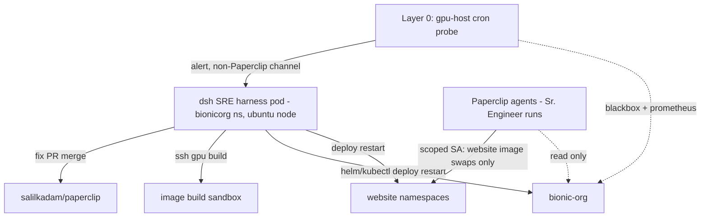

# External SRE Harness (DeepSeek `dsh`) + Scoped Website RBAC for Paperclip Agents

Date: 2026-10-16
Status: APPROVED FOR IMPLEMENTATION (operator decisions recorded in §8)
Updated: 2026-10-16 — namespace scope, RBAC pinning, batching, and alert
channel resolved by the operator.
Owner: Salil (operator) + Zed console (emergency lane)

## 1. Goal

Allow continuous monitoring and self-healing of the deployed Paperclip instance
(`bionicorg` / org.baisoln.com) without the self-healing paradox: the agents
that live *inside* Paperclip cannot heal Paperclip when Paperclip itself is
down (proven by the startup-recovery crash-loops of 2026-10-16, where the
server exited before boot and no internal agent could act).

Split responsibilities so every responder is colocated with its own failure
domain:

| Actor | Lives | May do | May never do |
|---|---|---|---|
| Layer 0 — dumb health prober | gpu host cron (outside cluster) | probe, alert human via non-Paperclip channel (ntfy/Discord/email) | fix anything |
| SRE harness (DeepSeek `dsh`) | `bionicorg` ns, own Deployment + own Helm release, scheduled on `ubuntu` node | monitor, diagnose, code fixes → PR → squash-merge to `salilkadam/paperclip`, build images via SSH on the gpu host, deploy/restart Paperclip and the website namespaces (incl. the `bionicaisolutions` agent-demo apps), re-wake stalled runs after restarts | self-modify/self-redeploy; merge without green local CI; touch any namespace outside the four in §3 |
| Paperclip agents (Sr. Engineer et al.) | inside the `bionic-org` pod | issue-tree work; website **content updates** (container image swaps) in the two website namespaces | any write in `bionicorg` (read-only there), any restart/scale/delete, any Paperclip deploy |
| Operator + Zed console | off-cluster | everything | — |

## 2. Cluster facts verified 2026-10-16 (read-only survey)

- **`web`** namespace hosts the Bionic AI Solutions website: deployments
  `baisoln-web` + `contact-api`; Kong ingress serves `baisoln.com`,
  `www.baisoln.com`, `www.bionicaisolutions.com` (+1 host).
- **`reliora-website`** namespace hosts the Reliora website: deployments
  `reliora-website` + `reliora-forms-api`; Kong ingress serves
  `reliora.ai`, `www.reliora.ai`.
- Neither website namespace has a Helm release today (raw `kubectl apply`
  manifests; missing `last-applied-configuration` annotations observed).
- **`bionicaisolutions`** namespace hosts the site's agent-demo apps
  (`agent-chatbot-with-avatar`, `agent-doctor-helper`, `agent-forms-filler`,
  `agent-help-desk`, `agent-medical-helper`, `agent-nbfc`,
  `agent-simple-qa-chat-bot`) — scope inclusion is an open question (§8).
- **`bionicorg`** hosts Paperclip (`bionic-org` Helm release, single replica,
  node `gpu`) and will host the harness. Agent runs execute as child
  processes inside the `bionic-org` container.
- `bionic-org-sa` currently has **zero RBAC bindings** — Paperclip cannot
  touch the API server today. The Helm chart's
  `templates/serviceaccount.yaml` is bare (token automount only).
- Prometheus + kube-state-metrics + blackbox-exporter (external/origin)
  already run in `gpu-monitor`; otel-collector in `observability`.
- External Secrets Operator is installed (`external-secrets` ns) and already
  used by the bionic-org chart (`externalsecret-*.yaml`); Vault path
  convention: `t6-apps/bionic-org/config`.
- Nodes: `gpu` (hosts Paperclip) and `ubuntu`.
- `deepseek-ai/deepseek-harness` (`dsh`) verified: MIT, Node-based,
  everything-is-a-plugin architecture, Web UI on :3080, **developer preview
  with breaking changes** (~22k commits, rapid iteration).

## 3. RBAC design — two SA/Role pairs, strictly namespaced

### A) `paperclip-agent-web-sa` — for Paperclip agent runs

Bound in `web` and `reliora-website` (one Role + RoleBinding per namespace):

- **Allowed:** `get/list/watch` on `deployments, pods, services, configmaps,
  events`; `get` on `pods/log`; `patch/update` on `deployments` **limited to
  container image swaps** (the only way marketing content changes on a
  containerized site).
- **Denied structurally:** `pods/delete`, `deployments/scale`,
  rollout-restart writes, `daemonsets/statefulsets/jobs`, `secrets`,
  `ingresses` writes, `pvcs`, and everything in `bionicorg`.
- **Per-deployment pinning (operator decision):** write rules use RBAC
  `resourceNames` so agents can image-swap **only** `baisoln-web` (in `web`)
  and `reliora-website` (in `reliora-website`). `contact-api` and
  `reliora-forms-api` are API plumbing, not marketing material, and are
  **excluded from agent write rights** (read-only for them).
- The agent-demo apps in `bionicaisolutions` are **harness-only** (operator
  decision) — no agent-web Role is bound there.
- **`bionicorg`:** separate **read-only** Role (`pods`, `pods/log`, `events`,
  `deployments`) so agents can diagnose symptoms without acting.
- Delivery: projected SA token volume mounted into the `bionic-org` pod +
  a new `website-publisher` skill that documents the exact allowed commands.
- Blast radius if an agent goes rogue: a website shows a wrong/stale image.
  Never Paperclip, never secrets, never deletes.

### B) `sre-harness-sa` — for the dsh pod

**Four namespaces** (`bionicorg`, `web`, `reliora-website`,
`bionicaisolutions` — the agent-demo apps are harness-managed per operator
decision), one Role + RoleBinding each:

- Full namespaced control: `apps/*` incl. `deployments/scale`, rollout
  writes, `pods/delete`, `pods/exec`; core `services/configmaps/
  secrets/ingresses/pvcs/jobs/cronjobs`; `events`; `pods/log`.
- Helm stores release state as `secrets` in the release namespace, so this
  is exactly sufficient for `helm upgrade --install` into the three
  namespaces and nothing more.
- No cluster-scoped rights: no `clusterroles`, nodes, proxy, impersonation,
  or cross-namespace reads.
- Hard SOP rule encoded in the harness skill set: **never delete or
  redeploy its own Deployment/SA/Role** — only the operator restarts the
  harness.

## 4. The dsh harness pod

- **Image:** build once on the gpu host from `deepseek-ai/deepseek-harness`
  at a pinned tag → `docker4zerocool/dsh:<pinned>`. Dev-preview churn means
  the cluster runs a pinned digest; upgrades are a deliberate, tested step.
- **Chart:** new `deploy/helm/sre-harness/` — deployed into the `bionicorg`
  namespace as its own release (own SA, own values, never selected by
  bionic-org cleanups). Note in the chart README: `deploy.sh` only applies
  the namespace, so Paperclip upgrades cannot sweep it, but manual
  namespace deletions would — recreate via the release, never by hand.
- **Placement:** `podAntiAffinity` on node `gpu` → schedules on `ubuntu`,
  so a gpu-host failure does not take Paperclip and its SRE down together.
  Builds still reach the gpu host over LAN SSH.
- **Brain:** DeepSeek API by default (off-cluster by definition — also the
  fallback brain if GPU-AI gateway or the Paperclip host is down).
  Optionally also GPU-AI gateway (`https://mcp.baisoln.com/gpu-ai/v1`) as a
  cheap local path. NOTE: gateway hosting location unverified; verify
  `mcp.baisoln.com` does not terminate in this cluster before P4.
- **State:** small PVC for dsh plugin/config/session state (persistent
  incident memory across restarts).
- **Secrets (Vault → ESO, existing pattern, `t6-apps/bionic-org/config`):**
  `harness_deepseek_api_key`, `harness_ssh_key` (gpu build host only),
  `harness_git_pat` (fork-scoped PAT, same guardrails as
  `sr_eng_agent_pat`).
- **Hygiene:** `automountServiceAccountToken: false` at pod level, token
  projected only where needed; modest requests/limits so it can never
  starve Paperclip; Calico NetworkPolicy default-deny-egress with
  allowances (DeepSeek API, gpu host SSH, API server, Paperclip) as a
  follow-up.

## 5. Layer 0 (dumb, outside)

- Cron/systemd timer on the gpu host (outside the cluster): probe
  `https://org.baisoln.com/api/health` (blackbox-origin already probes it —
  prefer reading Prometheus), plus `kube_pod_container_status_restart_total`
  alert rules from the existing `gpu-monitor` Prometheus.
- Alert channel is **not** Paperclip — it must fire precisely when
  Paperclip is unreachable. **Operator decision: Slack.**
  Slack credentials are pulled from Vault via the existing
  `ClusterSecretStore vault-backend`, path under `srenix/slack`
  (cluster KV2 convention suggests `t6-apps/srenix/slack` — confirm the
  exact path and property names, e.g. `webhook_url` or `bot_token`, with a
  throwaway ExternalSecret dry-run during P1 wiring; no cluster
  ExternalSecret references Slack today).
- Layer 0 never fixes anything and never files Paperclip issues. The
  harness opens the incident issue once Paperclip is reachable again, so
  the Paperclip inbox remains the single audit record.

## 6. Harness runbook (dsh plugins/skills)

Codify the operational lessons from 2026-10-16 verbatim:

- Triage: `diagnose-why-work-stopped` playbook; read `--previous` pod logs;
  the slot-conflict SQL probe predicting `issues_open_routine_execution_uq`
  crash-loops; startup-recovery failure signatures.
- Fix loop: branch → root-cause fix → **local** `pnpm -r typecheck`,
  `pnpm test:run`, `pnpm build` only (GitHub Actions disabled on cost
  grounds) → PR against `salilkadam/paperclip` only → squash-merge on
  green.
- Build: SSH gpu host, build from a scratch clone under a sandbox dir,
  cleanup afterwards; known failure modes: pnpm-install OOM in BuildKit
  (bound memory, retry), 260 MB build context, `deploy.sh`'s
  `--atomic --timeout 5m` false-failure/rollback trap.
- Deploy: call helm directly — `--timeout 10m`, **never `--atomic`**,
  prove a Ready pod before letting the old ReplicaSet drain, never roll
  while runs are in flight, verify a known-good API surface (gallery
  count, `/api/health`) before declaring success.
- Post-restart resume: query `heartbeat_runs` that died `process_lost` in
  the deploy window → requeue/wake via `POST /api/agents/:id/wakeup`;
  confirm hourly routine triggers fire again (the 18:00–20:00 silent window
  incident showed what un-woken patrols look like); confirm slot-conflicts
  = 0.

## 7. Phased rollout

1. **P0** — Fix the fatal startup-recovery crash (per-run claim conflict
   logs and skips instead of `process.exit(1)`). Prerequisite: the SRE's
   first incident must not be "the server can't boot to receive it."
   **Operator decision: P0 ships in the same batch as P1** (two PRs —
   server code and cluster RBAC — merged and deployed together).
2. **P1** — RBAC: both SA/Role pairs (agent writes pinned by
   `resourceNames`) + a `kubectl auth can-i` matrix test; mount the
   agent-web projected token into the bionic-org pod; ship the
   `website-publisher` skill; wire the Slack alert secret (Vault
   `srenix/slack`). Proof: Sr. Engineer ships one real marketing change
   and a synthetic health alert lands in Slack.
3. **P2** — dsh pod in monitor-only mode (harness SA bound read-only):
   alerts + incident-issue filing only.
4. **P3** — Harness gets write/deploy in `web` + `reliora-website`; it
   owns website rollouts alongside agent requests.
5. **P4** — Harness gets `bionicorg` write: full loop incl. Paperclip
   deploy + post-restart resume. Confirmation gate (harness asks the
   operator in chat/issue before a `bionicorg` rollout) stays mandatory
   until it has earned trust — mirrors the standing rule for the in-app
   Sr. Engineer (deploy manual, merges auto after green local CI).

## 8. Operator decisions (resolved 2026-10-16)

1. **`bionicaisolutions` agent-demo apps → harness-only.** No agent-web
   write rights there; harness SA covers that namespace (§3B).
2. **`web/contact-api` and `reliora-forms-api` excluded from agent write
   rights** — enforced via RBAC `resourceNames` pinning to `baisoln-web`
   and `reliora-website` (§3A).
3. **P0 ships in the same batch as P1** (separate PRs, one release).
4. **Layer-0 alerts land in Slack**, keys pulled from Vault `srenix/slack`
   via the existing `vault-backend` ClusterSecretStore (§5).

## 9. Top risks

- **`dsh` dev-preview churn** → pinned digest images; upgrades are tested,
  deliberate steps.
- **Prompt injection reaching an agent that holds a kubeconfig** → the
  RBAC scope *is* the mitigation: the agent token cannot touch
  `bionicorg` writes, secrets, or deletes; harness-side `bionicorg` deploys
  stay human-confirmed through at least P4.
- **Harness self-modification paradox** → harness never deploys itself;
  operator restarts it. Layer 0 and Layer 1 contain no LLM.
- **Single-node reality** → `gpu` node hosts Paperclip; scheduling the
  harness to `ubuntu` is the only available fault-domain split today.
- **Harness model dependency** → verify GPU-AI gateway independence;
  DeepSeek API default already hedges this.

## 10. Artifacts to produce at implementation time

- `deploy/helm/sre-harness/` chart (Deployment, SA, PVC, ESO secrets,
  anti-affinity, values for pinned tag).
- `deploy/rbac/` (or chart templates): `paperclip-agent-web-sa` +
  `sre-harness-sa`, Roles/RoleBindings (agent pair: `web` +
  `reliora-website` with `resourceNames` pinning + `bionicorg` read-only;
  harness pair: `bionicorg`, `web`, `reliora-website`,
  `bionicaisolutions`), and the `auth can-i` verification script.
- bionic-org chart: projected SA-token volume + env wiring for the agent
  website kubeconfig (behind a values flag, off by default outside this
  instance).
- `skills/website-publisher/` (agent skill) and harness-side dsh plugin
  packaging the §6 runbook.
- Layer-0 cron script + Prometheus alert rules + Slack alert step
  (ExternalSecret for the Slack credential from Vault `srenix/slack`,
  `vault-backend` store, `t6-apps/bionic-org/config` as the app path for
  any harness-side Slack tokens).
