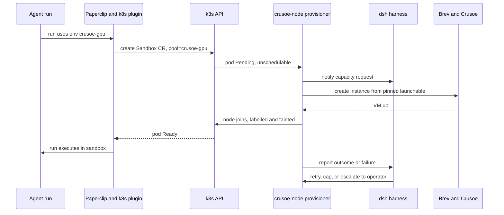
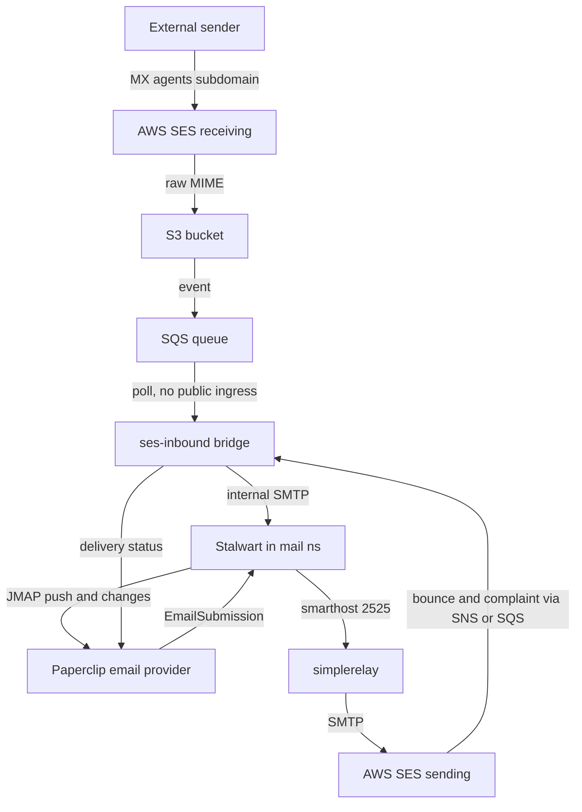
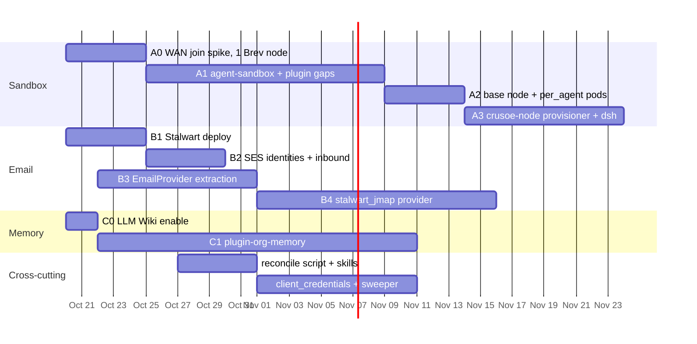

# Agent Sandboxes, Email, and Persistent Org Memory

Date: 2026-10-17
Status: Proposed. Operator decisions are recorded in §0; the rest still needs implementation.

## 0. Operator decisions (2026-10-17)

| # | Decision | Effect on this plan |
|---|---|---|
| D1 | **Sandboxes: join Crusoe (Brev) nodes to the existing k3s cluster.** When an agent asks for a sandbox, a node is created if none is available, and the external DeepSeek harness (`dsh`) carries out the provisioning. | §4. The harness supervises a deterministic provisioning tool and does not improvise; see §4.2. Agents share an always-on **node** but not a **sandbox**; see §4.3. |
| D2 | **Email domains: `reliora.ai` and `baisoln.com`. Reuse the `simple.baisoln.com` relay, which sends through AWS SES.** | §5. Both apex MX records point to **Google Workspace**, so agent mailboxes use subdomains (§5.2). |
| D3 | **Memory backend:** the operator asked which to prefer. | **Recommendation: keep the existing Letta and Graphiti; do not add Mem0 or Honcho.** Reasons in §6.1. |
| D4 | **Email server: Stalwart** as the basis for an AgentMail-like system. | §5. |
| D5 | **Base node: the existing Brev instance `paperclip-linux`**, a CPU machine. It may be rebuilt and joined to the cluster. | §11 records what was discovered. Rebuilding it is unnecessary because the box is still factory-fresh; the join uses the **partial-join** design in §11.3. |

> **2026-10-17 discovery changed two parts of this plan. §11 overrides any earlier section it contradicts:**
> 1. `simplerelay` can only send. It also **rewrites Message-ID, Date, Reply-To and From** on every message, which would break the rule that one email thread maps to one task. Stalwart therefore sends straight to SES (§11.4).
> 2. A full join over the WAN would need cluster-wide Calico and MTU changes. A **partial join** needs only one new Tailscale router pod on the LAN side (§11.3).

## 1. Goal

Every Paperclip agent, in every company on this instance, gets three capabilities:

1. **A sandbox.** The agent can create one, or reuse its own, on Crusoe capacity.
2. **Email.** The agent can send and receive mail.
3. **Persistent memory.** The agent's memory grows as it learns about the organization.

Each capability must follow Paperclip patterns:

- The underlying system is open-source software that we host ourselves.
- It is reached through a plugin or a connection.
- Its credentials stay usable without a human having to reconnect.
- Its skills are central, so every company gets them.

## 2. What already exists

| Need | In Paperclip / repo | On the cluster (verified 2026-10-17) |
|---|---|---|
| Sandbox | Kubernetes sandbox-provider plugin (`packages/plugins/sandbox-providers/kubernetes`), the `ssh` driver, and a Daytona plugin. The environment model supports `reuse_by_environment` leases. | k3s v1.33 on 6 nodes. CNI is **Calico VXLAN**: MTU 1450, `nodeAddressAutodetectionV4: firstFound`, BGP disabled. Flannel annotations remain on nodes, but no flannel pods run. **No `agent-sandbox` CRD.** The `gpu` node is a Tesla K80 using **GPU time-slicing** (`nvidia.com/gpu.shared: 10`) through `nvidia-device-plugin-config`. The `dsh` harness runs as `sre-harness` in `bionicorg`. Its RBAC covers 4 namespaces and has **no node rights** (`can-i create nodes` → no). |
| Email | AgentMail channel: each email thread becomes a task, and it has inbound, outbound, receipts, catch-up, a skill, and CLI commands. It is hosted SaaS and hard-coded into the server. | `simplerelay`: SMTP on `192.168.0.221:2525`, web UI at `simple.baisoln.com` behind oauth2-proxy, secrets `SES_SMTP_*` / `SES_REGION`, plus Google WIF config. `mail-bridge-server` (Loc-Mail) can only send. **DNS:** the `baisoln.com` and `reliora.ai` MX records point to Google. SPF already includes `amazonses.com`. DMARC is `p=none`. |
| Memory | Memory connectors in the hosted catalog; the `plugin-llm-wiki` plugin; the `para-memory-files` core skill. The memory-service plan (2026-03-17) is not implemented. | **Letta 0.16.7** (`docker4zerocool/letta:0.16.7-vllm-embed.1`, 3 replicas, `letta.baisoln.com`). A **Graphiti** REST service (`graphiti-service:8200`) on **FalkorDB v4.22**, using LLM and embedder endpoints set through env vars. A letta-media-bridge to MinIO. Loc-Letta MCP is OAuth-gated and exposes 0 tools. |

## 3. Paperclip patterns we reuse

These patterns are summarized below. Evidence for each is in the research notes from the first draft of this plan.

- **Connections.** Each connection belongs to one company. A generic remote MCP connection accepts any URL. Private cluster URLs are allowed because the deployment sets `PAPERCLIP_DEPLOYMENT_EXPOSURE=private`.
- **Token refresh.**
  - Tokens refresh on demand: when the token expires within 60 s, or after a 401.
  - A DB lease stops two replicas from refreshing the same token at once.
  - There is **no proactive refresh** and no `client_credentials` auth kind (§7.1).
- **Plugins.**
  - A plugin runs as an instance-wide worker and is enabled per company.
  - It can provide tools, events, jobs, a database namespace, and managed agents, routines and skills.
  - It reads company-scoped secrets through `ctx.secrets.resolve`.
  - Sandbox providers are themselves plugins.
- **Central skills.**
  - Repo `skills/` is imported into every company's library (`ensureBundledSkills`).
  - New agents receive only `PAPERCLIP_CORE_SKILL_KEYS`, so existing agents need a backfill (§7.3).

## 4. System A — Agent sandboxes on Crusoe nodes joined to k3s

### 4.1 Guidance: share the node, not the sandbox

Running one always-on Crusoe node is a sound choice. Every agent gets its own sandbox there instantly, and nobody waits for a node to boot. Several agents can share that **node**. They should not share one **sandbox**, meaning one OS user, one home directory and one workspace that every agent logs into over SSH.

| | One shared host, SSH login per agent | **One shared node, a persistent pod per agent** (recommended) |
|---|---|---|
| Always available | Yes | Yes. The pod stays running, and the agent's next run lands in it within seconds. |
| How the agent "connects" | SSH key per environment; rotate keys by hand | Paperclip `exec`s into the pod through the API server. No SSH keys exist to leak or rotate. |
| Files and secrets | Every agent can read every other agent's workspace, `~/.claude`, `~/.codex` and tokens, unless each agent gets its own Unix user and permissions are kept correct | Each agent has its own PVC-backed `/workspace` and home |
| A runaway process | Can starve or kill other agents' work | Limited to the pod's CPU, memory and GPU allocation |
| Network egress | Shared, with no per-task grants | Per-run NetworkPolicy, plus the existing task-scoped egress grants |
| Low-trust agents | Not allowed: `LOW-TRUST-PRESETS.md` requires the `sandbox` driver | Allowed |
| GPU | Uncoordinated sharing | Time-slicing (already used on the `gpu` node) or **MIG** for hard memory and fault isolation on A100/H100 |

So: keep one **base node** on all the time for the warm path, and add **burst nodes** on demand when the base node is full or a job needs a larger GPU (§4.2). The "connection is just an SSH login" convenience comes from `sandboxIdentity: per_agent`: the agent's pod is already running, so reconnecting is a pod exec with no handshake. The `ssh` driver stays available as a break-glass option for trusted agents only.

Agents use the sandbox in one of two ways:

1. **The agent runs inside the sandbox.** This is how Paperclip works natively. The agent's environment is set to `crusoe-gpu`, so the adapter CLI runs in the pod. This is the recommended mode.
2. **The agent stays in the `bionic-org` pod and sends jobs to a sandbox.** This would need a new "sandbox MCP" with exec and file tools. Defer it unless a real need appears.

### 4.2 Request → provision → attach flow

**Recommendation.** Keep the LLM out of the hot path. The signal that a node is needed is a **Kubernetes-native Pending pod**. A **deterministic provisioner** that has been reviewed (a script or a small controller) creates and joins the node. The **dsh harness supervises**: it is told about every event, handles failures (join timeout, Brev error, a stuck drain), decides capacity questions such as burst limits, and can run the same tool manually. If the provisioning credentials sat with the harness, an LLM that can also merge code and redeploy Paperclip would hold cloud-billing and cluster-wide node authority. The tool should hold those credentials instead.

**Provisioner (`crusoe-node`).** It runs in its own namespace, `paperclip-infra`, with its own ServiceAccount. It does not use the harness SA.

- **Trigger:** a Pending pod in any `paperclip-*` tenant namespace whose node selector is `paperclip.ai/pool=crusoe-gpu` and whose scheduling failure says the pool has no free node. Optionally also an explicit request: a Paperclip issue in an "Infra" project with label `sandbox-capacity`, which the harness polls.
- **Scale up:**
  1. Create a Brev instance from a pinned launchable/image on Crusoe.
  2. Run the bootstrap: Tailscale, k3s agent, NVIDIA driver and container toolkit, node labels and taints.
  3. Wait for `Ready` and for the GPU to be allocatable.
  4. Apply the per-burst limits and the monthly cap.
- **Scale down:** burst nodes only, after N minutes with no sandbox pods: cordon → drain (`pods/eviction`) → delete the Node → stop or delete the Brev instance. **Never scale down the base node.**
- **RBAC** (a cluster-scoped ClusterRole is unavoidable for nodes):
  - Allowed: `nodes` get/list/watch/patch/delete; `pods` get/list/watch cluster-wide (read only); `pods/eviction` create.
  - Guardrail: a **ValidatingAdmissionPolicy** (GA in v1.30; this cluster runs v1.33) that rejects patch, delete and cordon from this SA on any node **not** labelled `paperclip.ai/pool=crusoe-*`. The LAN nodes are then structurally out of reach.
- **Secrets:**
  - In Vault, synced by ESO to `paperclip-infra` only: `brev_api_token`, `k3s_agent_token`, and a `tailscale_oauth_client`. The Tailscale OAuth client mints **ephemeral, tagged, pre-authorized** auth keys, which avoids the 90-day auth-key expiry.
  - Brev token lifetime and refresh behaviour must be verified before build (open question Q1).
- **Harness integration:**
  - The provisioner posts events to the harness, and to Slack as the existing Layer-0 channel.
  - The harness gets a **read-only** ClusterRole for nodes and pods so it can diagnose. It also gets an "invoke `crusoe-node`" capability, as a dsh tool/plugin that calls the provisioner's HTTP API.
  - The harness never holds the Brev or k3s tokens.
- **Paperclip side:**
  - The Kubernetes plugin's readiness timeout must allow for a node to boot: a `leaseReadyTimeoutSec` of about 15 min for the `crusoe-gpu` environment (Brev boot time is to be measured).
  - While waiting, the run should show a clear status such as "waiting for sandbox capacity".

### 4.3 Joining Crusoe nodes over the WAN (network prerequisites)

The LAN nodes are behind NAT on `192.168.0.0/24`. A remote node needs all of the following:

| Path | Port | Why |
|---|---|---|
| Crusoe node → `cp1` API server | TCP 6443 | kubelet registration |
| API server → Crusoe kubelet | TCP 10250 | **`exec` and logs.** The Kubernetes plugin runs every command through exec. |
| Crusoe node ↔ every node (VXLAN) | UDP 4789 | Pod-to-pod traffic: the sandbox reaches the Paperclip server pod (bridge callback) and CoreDNS |
| Crusoe node → Typha | TCP 5473 | Calico data plane |

Proposed design:

1. **Tailscale:**
   - Run a **subnet router** on the LAN, on `cp1` or a small dedicated VM. It advertises `192.168.0.0/24`.
   - Add a LAN-side static route for `100.64.0.0/10` pointing at the router, either on the LAN gateway or on each node.
   - Run Tailscale on each Crusoe node with `--accept-routes`.
2. **k3s agent on Crusoe:** `--node-ip=<tailscale IP>`, `--node-label paperclip.ai/pool=crusoe-gpu`, `--node-taint paperclip.ai/pool=crusoe-gpu:NoSchedule`, `--kubelet-arg max-pods=…`.
3. **Calico:**
   - Change `nodeAddressAutodetectionV4` from `firstFound` to `kubernetes: NodeInternalIP`. LAN nodes keep their 192.168.0.x addresses, and Crusoe nodes advertise their tailnet IPs.
   - **MTU:** VXLAN over WireGuard/Tailscale (tailscale0 MTU 1280) needs a pod MTU of about 1230 or less. Calico MTU is global, so this lowers MTU for the whole cluster. Measure the LAN impact. The other option is a separate Crusoe IP pool with tuned host routes; validate it in the spike.
   - Node-level egress policy stays in **standard** NetworkPolicy mode. The cluster runs open-source Calico, not Cilium, so FQDN rules fall back to the plugin's public-IPv4 80/443 grant.
4. **GPU:**
   - The existing `nvidia-device-plugin` DaemonSet selects nodes with `nvidia.com/gpu.present=true`, so it schedules onto Crusoe nodes automatically once NFD or the node label is present.
   - Add a Crusoe-specific config: MIG strategy on A100/H100, or time-slicing replicas on cards without MIG.
5. **Storage:**
   - Use a **node-local** StorageClass (`local-path`) for per-agent PVCs on the base node. Ceph RBD or NFS over the WAN would be too slow.
   - Work is durable through the plugin's existing workspace sync-out to Paperclip, plus an optional nightly snapshot of agent homes to MinIO.
   - Burst nodes use `per_run` sandboxes only.

**Timeboxed spike first (A0).** Join one Brev/Crusoe VM by hand and prove `kubectl exec`, pod-to-pod traffic to the `bionic-org` pod, DNS, `nvidia-smi` in a pod, and throughput at the reduced MTU. If the stretched cluster is unstable, fall back to a **single-node k3s satellite** on the Crusoe VM. The Kubernetes plugin already supports `kubeconfigSecretRef`, and the satellite approach avoids changing Calico on the LAN.

### 4.4 Kubernetes plugin work

The current gaps were confirmed in code.

| Gap | Change | Files |
|---|---|---|
| Server namespace is hard-coded as `"paperclip"`; this deployment uses `bionicorg` | Add a `serverNamespace` config field | `src/plugin.ts:58`, `src/network-policy.ts`, `src/manifest.ts` |
| Resources accept only cpu and memory | Accept extended resources (`nvidia.com/gpu`, MIG profiles) | `src/types.ts:23-28`, manifest, builders |
| No node placement | Add `nodeSelector`, `tolerations` and `affinity` | `src/sandbox-cr-builder.ts`, `src/pod-spec-builder.ts` |
| Every volume is `emptyDir` | Add `persistence: { mode: per_agent \| per_issue \| none, storageClassName, size }` | builders, `src/lease-lifecycle.ts` |
| Resume code exists but `reusableLeases` is never declared, and release deletes the sandbox | Declare `reusableLeases`. Stop scales the sandbox to 0 and keeps the PVC (if agent-sandbox supports this; verify). Destroy deletes it. | `src/plugin.ts:471-609`, `src/sandbox-cr-orchestrator.ts` |
| No way to target a long-lived sandbox | Add `sandboxIdentity: per_run \| per_issue \| per_agent`. In `per_agent` mode, a stable name `pc-agent-<agentId>` lets the agent come back to the same sandbox. | builder, lease lifecycle |
| Tenant quota is hard-coded | Make it configurable, including GPU quota | `src/plugin.ts:65-71` |
| Readiness wait is too short for a node to boot | Add `leaseReadyTimeoutSec` and report waiting status | `src/lease-lifecycle.ts` |

Also install the pinned `kubernetes-sigs/agent-sandbox` controller, and publish a CUDA variant of `docker/agent-runtime` that keeps uid 1000 and the read-only root filesystem.

### 4.5 Environments and the central skill

- **Environments:**
  - `crusoe-gpu`: `per_agent`, base node, MIG or time-sliced GPU.
  - `crusoe-gpu-burst`: `per_run`, full GPU, may trigger provisioning.
  - `cpu-standard`: LAN nodes.
- Environments are company-scoped, so they are created per company by the reconcile script (§7.2).
- **`skills/sandbox-workbench`** explains:
  - which environment the agent is in, and what persists
  - how to request task-scoped egress
  - how to use the GPU (`nvidia-smi`, CUDA image)
  - that waiting for capacity is normal
  - never to store secrets in the workspace
  - to hand off artifacts through work products

## 5. System B — Email on Stalwart, with SES via simplerelay

### 5.1 Architecture

- **Keep the AgentMail channel semantics:**
  - one email thread maps to one task
  - mail is sent only when the agent explicitly sends it
  - outbound sends are durable intents
  - delivery receipts
  - external senders gain no board authority
- **Swap the provider.** Stalwart mailboxes are accessed over JMAP. This lives in core, as the AgentMail integration did.

### 5.2 Domains

The `baisoln.com` and `reliora.ai` apex MX records point to **Google Workspace**. Moving them would break human mail, so:

- **Agent mailboxes use subdomains:** `agents.baisoln.com` for the Bionic company and `agents.reliora.ai` for Reliora Inc. Addresses look like `ava@agents.reliora.ai`.
- **Later option for nicer addresses:** use Google Workspace routing (split delivery) to forward selected apex addresses, such as `support@reliora.ai`, to Stalwart. Keep this out of phase 1.
- **DNS per subdomain:**
  - MX → `inbound-smtp.<SES_REGION>.amazonaws.com`. First confirm that `SES_REGION` supports receiving.
  - SES Easy DKIM CNAMEs.
  - A custom MAIL FROM (`bounce.agents.<domain>`) with SPF `include:amazonses.com`, so DMARC aligns through both SPF and DKIM.
  - Both apex domains publish DMARC `p=none` (subdomains inherit it). Tighten it once alignment is verified.
- **Company ↔ domain binding** is enforced in Paperclip: the connection config lists the domains each company may use. Stalwart's native multi-tenancy may be an Enterprise feature (verify), so isolation must not depend on it.

### 5.3 Why inbound goes through SES

The cluster sits behind a NAT'd LAN IP, `org.baisoln.com` is proxied by Cloudflare (which only proxies HTTP), and inbound port 25 is usually blocked. **SES receiving → S3 → SQS → bridge** reuses the AWS account you already have, needs **no public ingress**, and gets SES spam and virus verdicts. The bridge copies those verdicts into headers that Paperclip's filters read.

The alternative is a public MX on the Crusoe base node, relaying over the tailnet. That mixes roles, so prefer SES.

### 5.4 Outbound through simplerelay

- Stalwart's outbound queue uses `simplerelay-smtp-lb:2525` as its smarthost (inside the cluster, or a ClusterIP Service added for port 2525).
- **Verify simplerelay first:**
  - Does it support SMTP AUTH per client?
  - Does it accept arbitrary From addresses on SES-verified domains?
  - Does it preserve Stalwart's DKIM signatures? SES Easy DKIM also signs, which is fine.
  - Does it rate-limit?
- If it cannot, Stalwart relays directly to SES SMTP using its own IAM SMTP credential. Scope that IAM policy with `ses:FromAddress` restricted to `*@agents.baisoln.com` and `*@agents.reliora.ai`.
- **Bounces and complaints:** SES sends them through SNS → SQS, and the bridge turns them into `failed` / `bounced` delivery status on the Paperclip send.
- **SES sandbox mode and sending quotas:** confirm the account is out of sandbox mode in that region.

### 5.5 Phases

**B1. Deploy Stalwart (namespace `mail`)**

- PostgreSQL storage on CNPG `pg-ceph` (new database `stalwart`); blobs in MinIO.
- JMAP and the admin UI are internal only. Expose the admin UI through Kong with oauth2-proxy and Keycloak, as `simplerelay` already does.
- Configure the smarthost to simplerelay.
- **Credentials:** the Stalwart admin API key lives in Vault (`t6-apps/mail/config`), is synced by ESO, and is entered once as the organization grant of the email connection in each company.

**B2. SES identities, receipt rules, S3/SQS, and the `ses-inbound-bridge` Deployment**

- The bridge's IAM user may only read that bucket and queue. Its keys live in Vault.

**B3. Extract an `EmailProvider` interface** from `server/src/services/email-channels.ts` and `agentmail-api.ts`. AgentMail becomes implementation #1. Shared contract tests:

- create or attach an inbox
- read threads and messages
- send or reply with an idempotency key
- push subscription
- catch up from a checkpoint
- delivery status
- normalize events
- filter automatic mail and spam

**B4. Add the `stalwart_jmap` provider**

- **Provider registration:**
  - Add it to `CHAT_PROVIDERS` and the validators.
  - Add a migration that relaxes the CHECK constraints in `chat_channels.ts` and `tool_access.ts:154`.
  - Generalize `receiveMode` in `email.ts`.
- **Server wiring:** update `email-connections.ts`, the health check, `routes/email.ts`, the app definition, the brand assets, and the setup wizard.
- **Inbox creation:**
  - Each agent's inbox is a Stalwart principal with a per-inbox app password. Paperclip creates both and stores them in its vault.
  - These credentials never expire, so nothing needs refreshing. Rotation is a board action.
- **JMAP mapping:**
  - threads → `threadId`
  - catch-up → `Email/changes` from the saved state string
  - receipts → `EmailSubmission` `deliveryStatus`, plus SES bounce events
  - idempotency → persist the intent first, then use a deterministic `Message-ID`

**B5. Make the skill provider-neutral**

- Create `skills/email`, and keep the `agentmail` skill as an alias.
- The `paperclipai email …` CLI is already provider-neutral.

**Interim.** `Loc-Mail` (send-only) and AgentMail (hosted) stay available until B4 ships.

## 6. System C — Persistent memory: existing Letta and Graphiti

### 6.1 Recommendation: keep Letta and Graphiti; do not add Mem0 or Honcho

| Criterion | **Letta + Graphiti (existing)** | Mem0 OSS | Honcho |
|---|---|---|---|
| Already running and operated | **Yes:** 3 Letta replicas, Graphiti, FalkorDB, a MinIO media bridge | No; a new service, plus Neo4j or another graph store for graph mode | No; a new service |
| "Grows with them" | Letta has **self-edited core memory blocks**, archival memory, **shared blocks** across agents, and sleep-time consolidation | Extracts facts from conversations; flat or graph | Builds a model of each **peer** (person); strong on users, weaker on org knowledge |
| Learning the org over time | Graphiti is a **temporal knowledge graph**: facts have valid-from and valid-to times, so it handles knowledge that changes ("X now owns billing"). It supports per-company namespaces (`group_id`) and hybrid search. | Facts are overwritten or deduplicated; little sense of time | Not its focus |
| Licence | Apache-2.0 (both) | Apache-2.0 | Verify (believed AGPL) |
| Risk | Letta is an **agent runtime**. Using it only as memory for Claude, Codex and OpenCode agents means using its REST APIs (blocks, passages) without running Letta's own LLM loop on the hot path. | Simpler API | Smaller ecosystem |

**Split of roles:**

- **Graphiti** is the organization's memory. It holds facts, entities, decisions and history. Each company has its own `group_id = company:<companyId>`, and every episode records where it came from (issue, comment or run ID).
- **Letta** is each agent's memory. Each Paperclip agent has one Letta agent with blocks `persona`, `working_context` and `lessons`, plus a **read-only shared `org_profile` block per company**, used as storage. A Letta sleep-time agent, running on the GPU-AI gateway model, consolidates memory nightly.
- **LLM Wiki** is the human-readable layer that people can browse and correct.

Fall back to Mem0 only if the Letta storage-only integration turns out to be too heavy.

### 6.2 Isolation

`doc/connections/MEMORY.md` warns that provider selectors are not enforced by Paperclip. Therefore:

- **Do not** give agents direct Loc-Letta or Graphiti connections in a multi-company setup. The first draft proposed that in phase C1; it is withdrawn.
- **`plugin-org-memory` is the only credential holder.** It derives `group_id`, the Letta agent ID and the block IDs from the run context, never from tool arguments.
- **NetworkPolicy:** `graphiti-service` currently shows no auth env vars, and Letta uses a single server password. Restrict ingress in the `letta` namespace to the `bionic-org` pod (where the plugin worker runs) and the existing consumers.

### 6.3 Phases

**C0. Now:** enable `plugin-llm-wiki` per company, including its event ingestion and routines. Keep `para-memory-files`.

**C1. `plugin-org-memory`**

- **Tools:** `memory_recall`, `memory_note`, `memory_forget` (destructive, so it uses Ask first) and `memory_profile`. The scope is injected by the plugin.
- **Event capture:**
  - Triggers: issue comments, documents and status changes, and run completion.
  - The resulting job writes a Graphiti episode carrying provenance, then appends to the agent's Letta archival memory.
  - Email and web content are marked untrusted: they are kept out of `org_profile` and can only become facts after review.
- **Routines:**
  - Nightly reflection: Letta core blocks are updated, `org_profile` is regenerated from Graphiti, and changes are summarized into LLM Wiki pages.
  - Weekly: a stale-fact and contradiction audit.
- **Plugin database namespace:** company and agent bindings, an operation audit, and cursors. Cost goes through the normal cost events, under budget hard stops.
- **Secrets:** the Letta password and the Graphiti credentials (if any) are read with `ctx.secrets.resolve` from company-scoped secrets fed from Vault. They are static, so nothing needs refreshing.
- **Managed skill:** `org-memory` ("recall at task start; note durable learnings at task end").

**C2. Core `pre_run_hydrate` hook (later):** automatically injects a small memory bundle into each run, as the 2026-03-17 plan specifies.

## 7. Cross-cutting

### 7.1 Credentials that never need a human to re-consent

| System | Credential | Lifetime | Refresh |
|---|---|---|---|
| Kubernetes plugin → cluster | In-cluster ServiceAccount token | Projected, rotated by the kubelet | Automatic |
| Provisioner → Brev | Brev API token (Vault → ESO) | **Verify (Q1)** | Rotation job if it expires |
| Provisioner → Tailscale | OAuth client → ephemeral auth key per node | Client does not expire; keys are single-use | Minted per join |
| Crusoe node → k3s | Agent join token | Long-lived | Rotated by the operator |
| Paperclip → Stalwart | Admin API key; per-inbox app passwords | Do not expire | Board-initiated rotation |
| Stalwart → simplerelay or SES | SMTP credential | IAM SMTP credentials do not expire | Rotate in Vault |
| Bridge → S3/SQS | IAM keys scoped to the bucket and queue | Do not expire | Rotate in Vault |
| Memory plugin → Letta / Graphiti | Server password / key | Does not expire | Rotate in Vault |

There is still core work for any OAuth-protected service, such as Loc-Letta behind Keycloak realm `mcp`, or future connectors:

- Add an `oauth2_client_credentials` auth kind (`packages/shared/src/types/tool-access.ts`, `server/src/services/tool-access.ts`, `tool-gateway.ts`, and the setup UI).
- Add a proactive refresh sweeper for OAuth grants that warns on `needs_reauthorization`.
- Optionally implement the `vault` secret provider, which is a stub today.

### 7.2 Reconciling across all companies

Connections, environments and plugin settings are all company-scoped. Add `deploy/scripts/reconcile-platform-capabilities.sh`, generalizing `register-cluster-mcp-servers.sh`. For every company it:

- enables and configures `plugin-kubernetes`, `plugin-org-memory` and `plugin-llm-wiki`
- creates the `crusoe-gpu`, `crusoe-gpu-burst` and `cpu-standard` environments
- creates the Stalwart email connection, limited to that company's domain

Run it after each deploy, and have the harness run it whenever a company is created.

### 7.3 Central skills

- Add `skills/sandbox-workbench` and `skills/email` to repo `skills/`, which is imported into every company. `org-memory` ships as a plugin-managed skill.
- Attach the skills to agents in one of two ways:
  - Add the keys to `PAPERCLIP_CORE_SKILL_KEYS` and backfill existing agents' `paperclipSkillSync.desiredSkills` with a one-time script.
  - Or add an instance setting, "default skills for all agents".
- Every skill must degrade cleanly when its capability is not bound to the agent.

## 8. Sequencing

Durations show relative size only. See §11.6 for the revised A0 steps.

## 9. Open questions and risks

1. **Q1 — Brev.** API surface, token lifetime, boot time, how public IP and firewall work on Crusoe-backed instances, and whether launchables can pin an image. Needed before A3.
2. **Q2 — simplerelay.** Does it support SMTP AUTH and arbitrary verified From addresses, and does it preserve DKIM signatures? If not, Stalwart relays directly to SES.
3. **Q3 — SES receiving.** Does `SES_REGION` support receiving? If not, receiving needs its own region.
4. **Q4 — GPU type on Crusoe.** It determines MIG versus time-slicing and the CUDA base image.
5. **Q5 — Base-node cost.** An always-on GPU node bills 24/7. An alternative is an always-on CPU base node with GPU burst only.
6. **Stretched-cluster risk.** The global Calico MTU change and exec latency over the WAN. The A0 spike decides between joining nodes and the satellite fallback.
7. **agent-sandbox is alpha.** Pin the version.
8. **Stalwart is AGPL-3.0, and multi-tenancy may be an Enterprise feature.** Company isolation is enforced in Paperclip.
9. **Memory poisoning.** Inbound email and web content must not become trusted org facts without review (§6.3).

## 10. Verification per phase

- **A0:** On a joined Crusoe node: `kubectl exec`, `nvidia-smi` inside a pod, a curl from the pod to the `bionic-org` Service, DNS, and an iperf throughput test at the new MTU.
- **A2:** An agent runs on `crusoe-gpu`, writes a file, finishes, and its next run comes back to the **same pod and PVC**.
- **A3:** With the base node full, a run for `crusoe-gpu-burst` provisions a node, completes, and the node is drained and removed after the idle window. The harness receives every event, and a forced join failure produces a harness escalation.
- **B:**
  - Provider contract tests against both AgentMail and Stalwart fakes.
  - A live round trip for each domain: inbound mail creates a task, the agent replies once, delivery status is recorded, a synthetic SES bounce becomes `failed`, and catch-up after a restart works.
  - DMARC aligned in the received headers.
- **C:**
  - Scope-injection tests.
  - A fact noted in run 1 is recalled by a different agent in the same company, and **not** in another company.
  - Nightly reflection updates `org_profile` and the wiki.
- **Before PR:** `pnpm -r typecheck`, `pnpm test:run`, `pnpm build`.

## 11. Crusoe/Brev and relay discovery (2026-10-17)

All evidence below is from read-only inspection: `brev ls` / `brev search` / `brev exec`, the k3s API, and the `simplerelay` pod. Nothing was changed.

### 11.1 Brev organization and Crusoe inventory

- **Active org:** `Bionic-AI-Solutions-Crusoe-Compute-Program`. There is also a personal org, `salil.kadam-0-gack`.
- **Running instances:**

  | Name | Type | GPU | Note |
  |---|---|---|---|
  | `paperclip-linux` | c1a.8x | – | Base-node candidate (§11.2) |
  | `comfyui-a100` | a100-80gb.1x | A100 | |
  | `psychiatric-maroon-sailfish` | a100-80gb.1x | A100 | |
  | `srenix-k8s-1`, `srenix-k8s-2` | c1a.4x | – | Their own **k3s v1.31** cluster on the Crusoe private network (`172.27.48.0/20`, flannel) |
  | `srenix-test-runner` | c1a.4x | – | |

  The two A100s cost about $1.98/h each. Confirm they are still needed.
- **Crusoe types offered through Brev:**
  - CPU `c1a.{2..176}x` at $0.048 per vCPU-hour, 4 GiB RAM per vCPU.
  - CPU `s1a.{20..120}x`.
  - GPU **L40S 48 GB** (1/2/4/8×, $1.74 per GPU-hour, compute capability 8.9). L40S has **no MIG**, so GPU sharing uses time-slicing.
  - GPU **A100 80 GB** (1/2×, $1.98 per GPU-hour, compute capability 8.0). A100 **supports MIG** (up to 7 slices).

  This answers Q4.
- **Instance properties** (Crusoe types):
  - Boot time about **420 s**.
  - Stoppable (stop and restart keeps the disk); not rebootable.
  - **Flex ports**: firewall rules can be changed.
  - **Fixed 128 GB disk** (minimum = maximum = 128).
- **Brev authentication (Q1):**
  - The CLI holds a **15-minute NVIDIA JWT access token** plus an opaque refresh token in `~/.brev/credentials.json`.
  - `brev login --token` exists for unattended login.
  - The refresh token's lifetime is **not documented**. The previous session on this host had already expired.
  - The provisioner should therefore use a dedicated Brev service identity with its refresh token in Vault, and treat `brev ls` failure as a "re-login needed" alert to the harness and Slack. Ask NVIDIA about org API keys.
  - `brev secrets` (versioned org secrets) also exists, which can hold Paperclip-specific values on the Brev side.
  - **Verified later on 2026-10-17:**
    - The refresh token does **not** rotate when used. Its hash was unchanged after an expired access token was refreshed.
    - `ssh <instance>` mints a **~5-minute SSH certificate per connection** (`brev mint-cert`), so on-demand SSH needs a live session but no long-lived key.
    - The CLI also supports **Brev API keys** (`bak-…`, hidden `brev login --api-key`, or the `BREV_API_KEY` env var). An API key is the preferred credential for the in-cluster provisioner, because it removes session expiry altogether. Where to create a key is not documented in the CLI; check the Brev console.
  - **Heartbeat:** `deploy/scripts/brev-heartbeat.sh` keeps the operator session alive.
    - Every 10 min it runs `brev ls`, which renews the session.
    - Every hour it runs `brev refresh`, which updates the SSH config.
    - Each cycle it SSH-probes `paperclip-linux`.
    - It writes `~/.brev/heartbeat/status.json` and alerts on state changes, with an optional Slack webhook.
- **Provisioning commands:**
  - `brev create <name> --type c1a.8x|l40s-48gb.1x|a100-80gb.1x --startup-script @bootstrap.sh` (falls back through a list of types)
  - `brev stop` / `brev start` / `brev delete`
  - `brev exec <name> '<cmd>'`

  These are everything the `crusoe-node` provisioner (§4.2) needs.

### 11.2 `paperclip-linux` (the base node)

- **Machine:** Ubuntu 22.04.5, kernel 5.15, 8 vCPU, 31 GiB RAM, 124 GB root disk (7% used). Passwordless sudo for `ubuntu`. Docker is installed.
- **Contents:**
  - Running: only Brev defaults (Jupyter :8888, InfluxDB :8086, Grafana on localhost, osquery `orbit`) and the NetBird agent.
  - Home directory created 2026-10-15, holding only Brev scaffolding. No crontab, no user workloads.
  - **Nothing needs to be preserved, so there is no need to delete and recreate it.** Disable Jupyter, InfluxDB and Grafana before joining.
- **Networking:**
  - Private `ens3` 172.27.53.113/20; public 216.86.169.255. Only **TCP 22** answers from the internet.
  - `wt0` 100.73.233.208 is **Brev's** NetBird management mesh. Its peers are Brev's `prd-*` relays, so it is not usable for our traffic.
  - From the box, `https://org.baisoln.com/api/health` returns **200** through Cloudflare. That means sandbox → Paperclip callbacks can use the public URL.
  - It **cannot** reach the LAN (`192.168.0.204:6443`: no route). The home public IP refuses 6443.
- **Capacity:** about 6–7 concurrent sandboxes at 1 vCPU / 4 GiB each, with roughly 10 × 8 GB per-agent persistent volumes on `local-path`. Use c1a.16x if more is needed.

### 11.3 How to join: a partial join, not a fully meshed one

Facts that shape the design:

- The LAN cluster uses Calico VXLAN with `nodeAddressAutodetectionV4: firstFound` and MTU 1450. Every node's internal IP is on `192.168.0.0/24`.
- A Tailscale tailnet (`tail59eeb2.ts.net`) already exists. The in-cluster `shell/ssh-bastion` pod is on it, as are Salil's Mac mini and this devcontainer.
- **Inference to verify:** k3s defaults to `--egress-selector-mode=agent`. In that mode the API server reaches each kubelet (for `exec` and logs, which the Kubernetes plugin uses for everything) **through the tunnel the agent opens to the server**. If that holds, the LAN side never needs to route to the Crusoe node for `exec`.

**Partial join.** This needs one LAN-side change and **no Calico or MTU change**:

1. **Router:** add a dedicated Tailscale subnet-router Deployment in a new namespace, `net-crusoe`. It advertises only the LAN hosts the Crusoe node must reach: `192.168.0.204/32` (API server) and the Typha hosts `192.168.0.201/32` and `192.168.0.2/32`, with SNAT on. A Tailscale ACL limits `tag:paperclip-crusoe` to those ports: 6443 and 5473. *Operator action: an auth key or OAuth client, plus route approval or an autoApprovers ACL entry.*
2. **On `paperclip-linux`:** install Tailscale (`--accept-routes`, tag `tag:paperclip-crusoe`) and the k3s agent **v1.33.4+k3s1** (matching the server), with:
   - `--server https://192.168.0.204:6443`
   - `--node-label paperclip.ai/pool=crusoe-cpu`
   - `--node-taint paperclip.ai/pool=crusoe:NoSchedule`
   - `--kubelet-arg max-pods=110`
3. **Join token:** use a short-lived bootstrap token (`k3s token create --ttl 1h`, run on `cp1`), not the permanent server node token.
4. **DaemonSets that will land despite the taint:**
   - `calico-node` and `csi-node-driver`: required.
   - `velero/node-agent` and `storage-maintenance/node-fstrim`: add a `nodeAffinity` that excludes `paperclip.ai/pool`.
   - MetalLB `speaker` and the rook-ceph CSI plugins do **not** tolerate the taint, so they stay off the node. That matters: a remote MetalLB L2 speaker or Ceph mount would be wrong.
5. **What does not work, by design:** cross-site pod-to-pod traffic. Sandbox pods therefore:
   - use `dnsPolicy: None` with public resolvers (or a node-local DNS forwarder), not cluster CoreDNS;
   - call Paperclip through `https://org.baisoln.com`, not the in-cluster Service;
   - get their egress NetworkPolicy from Paperclip's public egress rule instead of the `paperclip-server` pod selector.

   This needs new Kubernetes plugin config (`serverCallbackUrl`, `dnsConfig`) in addition to the §4.4 list.
6. **Fallback:** if the egress-selector tunnel or Calico on the remote node misbehaves, run a **single-node k3s satellite** on `paperclip-linux` and target it with `kubeconfigSecretRef`, reached through the same tailnet. The Crusoe `srenix-k8s-*` cluster shows that this pattern already works on Crusoe.

### 11.4 `simplerelay` (Q2): send-only, and it rewrites messages

- **What it is:** Postfix plus a FastAPI admin app.
  - SMTP submission on `:2525` (LAN LoadBalancer `192.168.0.221`); admin UI `simple.baisoln.com` behind oauth2-proxy.
  - `mydestination =` is empty, so it **hosts no mailboxes and receives no internet mail**.
  - "Receive" only means accepting submissions from authorized clients: by IP/CIDR, or SASL username and password (`AllowedClient`).
- **Routing:** per-sender-domain transports send `*@baisoln.com`, `*@reliora.ai`, `*@bionicaisolutions.com`, `*@srenix.ai` and `*@gharkaam.in` to **SES us-east-1** (`email-smtp.us-east-1.amazonaws.com:587`), and `*@zippio.ai` to Google's SMTP relay.
- **Blocker for agent email:**
  - Its pipe transport (`clean_message`) **replaces Message-ID** with `<em{uuid}@domain>`, replaces Date, forces `From` to the bare envelope sender (dropping the display name), forces `Reply-To = sender`, and re-encodes 8-bit bodies.
  - Replies would then reference a Message-ID that Stalwart and Paperclip never recorded. A reply would start a new thread and a new task, and agent-set Reply-To or plus-address routing would be lost.
- **Decision:** Stalwart's outbound queue goes **directly to SES SMTP us-east-1**, using a new IAM SMTP user whose `ses:FromAddress` is limited to `*@agents.baisoln.com` and `*@agents.reliora.ai`.
  - This uses the same SES account and identities simplerelay uses.
  - simplerelay stays unchanged for its current senders.
  - The other option is a "passthrough" provider mode added to simplerelay that skips `clean_message`. That means changing someone else's service, so it is not recommended.
- **Q3 resolved:** SES region **us-east-1 supports email receiving**, so the §5.3 inbound path (SES → S3 → SQS → bridge) stays in the same account and region.
- **Threading hardening:** if SES also replaces Message-ID on SMTP sends (to be verified with one test send), thread replies through **sub-addresses** carried in the address itself: `agent+c<conversationToken>@agents.<domain>` as From/Reply-To. Stalwart delivers sub-addresses to the base mailbox.

### 11.5 Answers to Q1–Q5

| # | Answer |
|---|---|
| Q1 | Brev uses a 15-minute NVIDIA JWT plus a refresh token of undocumented lifetime. Boot time is about 420 s. Crusoe instances can be stopped, and firewall ports can be changed. Use a dedicated Brev identity with its refresh token in Vault; on auth failure, alert the harness and Slack. |
| Q2 | Send-only, and it rewrites headers, so it is unsuitable as Stalwart's smarthost. Stalwart sends straight to SES us-east-1 (§11.4). |
| Q3 | us-east-1 supports SES receiving. |
| Q4 | Crusoe offers L40S 48 GB (time-slicing) and A100 80 GB (MIG). Start GPU burst on **L40S 1×** (cheaper) and keep A100 for jobs that need MIG or 80 GB. |
| Q5 | The base node is the **CPU** box `paperclip-linux` (c1a.8x, about $0.38/h ≈ $280/month). GPU capacity is burst-only. |

### 11.6 Revised A0 runbook

Steps 1–3 need operator inputs; steps 4–7 can then be automated.

1. **Operator:** create a Tailscale tag `tag:paperclip-crusoe`, an ACL that lets it reach only `192.168.0.204:6443` and `192.168.0.{201,2}:5473`, and an **OAuth client** (or a one-time pre-approved auth key) for the router and the node.
2. **Operator:** approve the router's advertised `/32` routes (or add `autoApprovers`).
3. **Operator:** confirm the partial-join design (adds one node and one router pod to the production cluster).
4. Deploy the `net-crusoe` Tailscale router (secret from Vault through ESO).
5. Run `k3s token create --ttl 1h` on `cp1`, through an operator shell or a one-off job.
6. On `paperclip-linux`:
   - disable Jupyter, InfluxDB and Grafana;
   - install and bring up Tailscale;
   - install k3s agent v1.33.4+k3s1 with the labels and taints above;
   - verify the node is `Ready`.
7. **Verify:**
   - `kubectl exec` into a test pod on the node, which proves the egress-selector tunnel;
   - from the pod, HTTPS to `org.baisoln.com`, and DNS with the custom `dnsConfig`;
   - `calico-node` is Ready;
   - no unintended workloads landed on the node;
   - LAN nodes are unaffected: no new routes, Calico configuration unchanged.

   Rollback: `kubectl delete node`, `k3s-agent-uninstall.sh`, and delete the router.

## 12. PROVEN: ssh-docker sandbox provider live end-to-end (2026-10-18 00:23 UTC)

**The original goal is achieved and verified.** A real Paperclip agent turn executed
inside a per-lease Docker container on `paperclip-linux` (Crusoe via Brev), driven
entirely through the Paperclip product surface:

1. Board issue **BIO-16** assigned to WebEngineer (`opencode_local`).
2. Server-side, the **`paperclip.ssh-docker-sandbox-provider` plugin** (this repo,
   `packages/plugins/sandbox-providers/ssh-docker/`, 22 unit tests green) acquired a
   lease: SSH from the bionic-org pod → `docker run` on `216.86.169.255`.
3. `opencode` ran in container `ca4c309a5f7b` from image
   `paperclipai/agent-runtime-opencode:sandbox` (built on the host: `node:24-bookworm`
   + ripgrep + `opencode-ai`, non-root `node` user; source:
   `.scratch/Dockerfile.sandbox-opencode`).
4. The agent posted the proof comment (INSIDE_DOCKER / node v24.22.0 /
   `pwd=/home/node/paperclip-workspace`) and moved BIO-16 to **done** itself.

### 12.1 Deployment recipe (repeatable, provider-swap ready)

- Bundle: `pnpm install --ignore-workspace` in the plugin dir (needs the
  `node_modules/@paperclipai/plugin-sdk -> ../../../../sdk` symlink, same as exe-dev),
  `pnpm bundle`.
- `kubectl cp` the `bundle/` dir into the server pod; `POST /api/plugins/install
  {packageName:"<pod path>", isLocalPath:true}` (board actor; worked on the
  `2026.1012.0` image).
- `POST /api/companies/:id/environments {driver:"sandbox", config:{provider:
  "ssh-docker", host, sshUser:"ubuntu", sshPrivateKey:<brev.pem>, knownHosts:<keyscan>,
  image:"<CLI-preinstalled image>", containerUser:"node", reuseLease:true, cpus, memory,
  dropCapabilities:true}}`; probe → 201/ok. Config PATCH merges and preserves the
  secret-ref binding when the secret field is omitted.
- Bind via agent `defaultEnvironmentId`; execution flows normally.
- **Provider swap = new environment config** (host/key/image). No server fork anywhere.

### 12.2 Incidents found (product follow-ups)

1. **Stale workspace-restore lock (fixed by hand on this instance).**
   `packages/adapter-utils/src/workspace-restore-merge.ts` `isLockStale()` does a
   PID-only `process.kill(pid,0)` liveness check; after a pod restart the recycled PID
   (7) made an 3-day-old `owner.json` look alive, permanently stalling restores for
   that workspace key. Fix: store boot-id/process-start-time (or instance generation)
   in `owner.json` and verify that, not just the PID.
2. **CLI provisioning UX.** Runs fail with `Command "opencode" is not installed` on a
   bare `node:24` image; the plugin documents preinstalled CLIs but the error should
   point at the image config. Ship a published `paperclipai/agent-runtime-opencode`
   image (extend `docker/agent-runtime/buildx-bake.hcl`).
3. **Failed-lease containers linger with `reuseLease:true`** (3 dead `node:24` containers
   accumulated; removed by hand). Needs lease GC on run-failure.
4. **Board-key bootstrap on an `authenticated` instance** still has no API route; this
   session minted `board_api_keys` rows directly (28 identical prior rows exist,
   same owner — established pattern). Key `sandbox-brev-proof-2026-10-17` expires
   7 days after 2026-10-18; revoke when tracks close.

### 12.3 Remaining work (not blocking the proof)

- Repo PR: plugin is present but **not yet in** `BUNDLED_PLUGIN_CATALOG`
  (`server/src/services/bundled-plugins.ts`) or `CLOUD_BUNDLED_PLUGINS`; add both +
  `SELF_HOSTED` docs so the image ships it (creation-path documented in
  `packages/plugins/sandbox-providers/createos/README.md`).
- Rebind WebEngineer permanently to the Brev env (currently bound; set
  `defaultEnvironmentId:null` to revert — BIO-3 production work runs there while bound).
- Optional: bake node CLI install into a broader image matrix (claude/codex variants).
- Node-join path (§11.3) stays deferred; it is an optimization (shared pool via
  k8s), while this plugin path is the shipping product surface.
- Sandbox sharing (one warm container per company/agent reused across runs):
  already covered by `reuseLease:true` per lease; a shared-team-sandbox mode would be
  a follow-up config on top of the same plugin (namePrefix + no per-run destroy).

## 13. Ship record — PR #38, merge, deploy (2026-10-18 ~04:50 UTC)

### 13.1 What shipped

- **PR #38** `feat(plugins): add ssh-docker sandbox provider` — squash-merged to `main`
  (`13c96c5c1`). Contents: the full `packages/plugins/sandbox-providers/ssh-docker`
  package (now daytona-convention complete: `tsconfig` `paths` for the SDK, standalone
  `pnpm-workspace.yaml`, README, lockfile, proven `image/Dockerfile`),
  `BUNDLED_PLUGIN_CATALOG` entry `ssh-docker`, `CLOUD_BUNDLED_PLUGINS="daytona ssh-docker"`,
  `deploy/scripts/brev-heartbeat.sh`, and this plan doc.
- **Deployed:** `main` head `81a2ba82c` (includes #38; the SRE harness merged #39 during
  this session) → `docker4zerocool/bionic:81a2ba82c` → helm rev **47**, pod
  `bionic-org-79f548d6c9-jtsm9`, image tag == main short SHA. Post-deploy checks:
  plugin `ready`, env `4123fb2c…` probe `ok` (fresh lease `paperclip-4123fb2c-895e4494`,
  node v24.22.0), WebEngineer `defaultEnvironmentId` intact → **permanent binding (b) is
  durable** through deploys.
- Plugin image choice: committed `image/Dockerfile` reconciled to the *proven*
  `.scratch/Dockerfile.sandbox-opencode` recipe (opencode-only); the richer
  claude/codex variant stayed untested and was dropped.

### 13.2 Build/deploy gotchas learned (operational record)

1. **Devcontainer cannot build the image.** Its cgroup caps at 48 GiB; Zed language
   servers held ~33 GiB, so the root `pnpm install --frozen-lockfile` layer died with
   `cannot allocate memory` twice. **Build host = `paperclip-linux`** (`~/paperclip-build`,
   clone `-b main` — repo default branch is `master`, clone must say `-b main`). Host
   BuildKit cache made the whole build+push ~5 min.
2. `build-and-push.sh` **deletes the local image after push**; its short SHA is 7 chars
   on the host, while `deploy.sh` uses the (9-char) **local** `git rev-parse --short HEAD`.
   Alias-push the extra tag (`docker tag …:81a2ba8 …:81a2ba82c && docker push …`) or pass
   through, otherwise `deploy.sh` deploys a nonexistent tag.
3. **`deploy.sh --timeout 5m` is too short** for a cold image pull (~100 s) + boot: first
   attempt rolled back (rev 45 failed → rollback 46). Manual re-run with `--timeout 15m`
   succeeded (rev 47). Consider raising the script timeout.

### 13.3 The `/tmp` install incident (durability fix, keep in mind forever)

The live plugin install recorded `package_path=/tmp/…` (the pod's writable layer). The
rollout wiped `/tmp` → `Activation failed: Package root not found`. Fixed by copying the
bundle to the **PVC** at `/paperclip/bundles/ssh-docker`, updating `plugins.package_path`
in-place (row `0375dec5-…`), and `POST /api/plugins/:id/enable`. **Any local-path plugin
install on this instance must live under `/paperclip` to survive restarts.** (Upstream
could harden this by rejecting `isLocalPath` installs outside persistent roots.)

### 13.4 Local gate notes

- `cargo` is not installed here → `pnpm -r typecheck` / `pnpm test:run` / `pnpm build`
  cannot run repo-wide (`paperclip-runner` + `server` depend on the Rust vendor build).
  Gate actually run: plugin 22/22; `server` `tsc --noEmit` clean;
  `cloud-image-bundled-plugins` + `distribution-plugin-catalog` + `bundled-plugins` green;
  all 54 `plugin-*`/`environment-*` server suites green (`plugin-orchestration-apis`
  needs a standalone run — 90 s, parallel-load flake only). Docker image build (which
  has the Rust stage) doubles as the `build` gate.
- `pnpm test:run` repo-wide exceeded 40 min on this box (serial stable runner + real-PG
  integration suites). Killed; orphaned `tsx` servers from a killed run must be reaped
  (`pgrep -f tsx`) or they starve everything.
